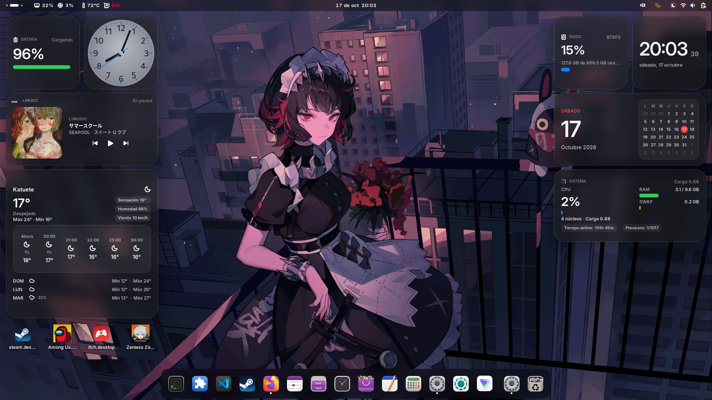

# Widgets for GNOME



Widgets is a GNOME Shell extension for placing customizable widgets on the desktop. It brings useful information and tools into view, with a look that can blend into the desktop using blur effects.

The extension declares compatibility with GNOME Shell 50 and 51.

## Dependencies

Install these GNOME extensions before enabling Widgets:

- **Blur my Shell**: provides the blur effects.
- **Add to Desktop**: allows items to be displayed on the desktop.

You can install them using the **Extension Manager** app or from [extensions.gnome.org](https://extensions.gnome.org/). These dependencies are installed separately and are not included in this project.

## Installation

1. Install and enable **Blur my Shell** and **Add to Desktop**.
2. Download this repository from GitHub using **Code > Download ZIP**, then extract the archive.
3. Copy the project folder to `~/.local/share/gnome-shell/extensions/` and rename the copied folder to `widgets@kin`.
4. Compile the settings schema in a terminal:

   ```sh
   glib-compile-schemas ~/.local/share/gnome-shell/extensions/widgets@kin/schemas/
   ```

5. Enable the extension:

   ```sh
   gnome-extensions enable widgets@kin
   ```

If the extension does not appear or activate, log out and back in. On GNOME running on Xorg, you can also restart GNOME Shell by pressing `Alt` + `F2`, entering `r`, and pressing `Enter`.

## License

Copyright (C) 2026 olasoykin

This project is licensed under the GNU General Public License, version 3 or (at your option) any later version. See [LICENSE](LICENSE) for the full text.
